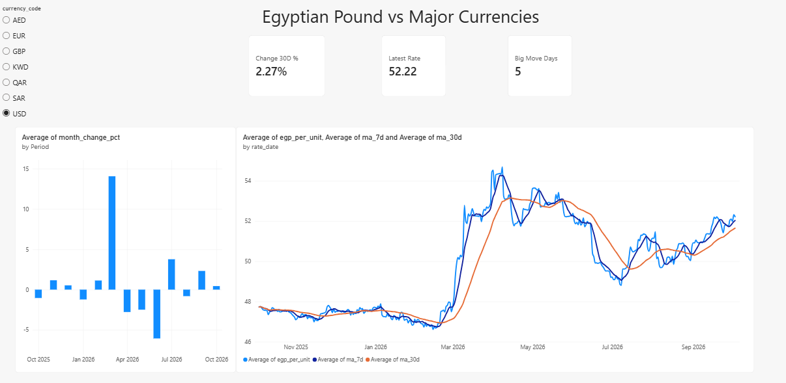
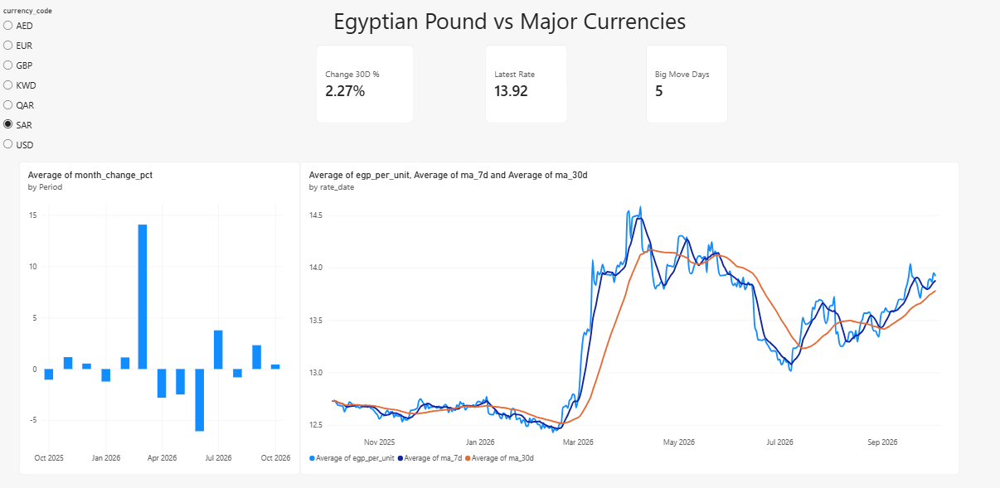

# Egypt FX Tracker — Automated Daily Data Pipeline


A Python + SQL Server pipeline that collects daily exchange rates of the **Egyptian pound (EGP)** against USD, EUR, GBP and the Gulf currencies (SAR, AED, QAR, KWD), stores them in a star-style schema, and analyses trends, volatility and big moves with SQL window functions. A scheduled task runs it every day with no manual work.

## Why this project
Anyone who works with Egyptian or Gulf businesses cares about the EGP rate. This project shows the full data workflow on **real, daily-updating data**: ingestion → cleaning/validation → warehouse → analysis → dashboard → automation → tests.

## Architecture
```
Free FX API (no key)          Python                       SQL Server Express            Dashboard
fawazahmed0/currency-api  ->  extract.py (retry+fallback)  ->  fact_fx_rate        ->    Power BI / Tableau
                              transform.py (pandas,           dim_currency
                                 validation, cross-rates)     vw_fx_daily (window fns)
                              load.py (idempotent MERGE)      vw_fx_monthly
        ^
        |__ Windows Task Scheduler runs run_daily.bat every day
```

## Tech stack
Python (requests, pandas, pyodbc) · SQL Server / T-SQL (window functions, MERGE, views) · pytest + GitHub Actions · Windows Task Scheduler · Power BI / Tableau

## Key design decisions
- **Idempotent loads**: `MERGE` means re-running the pipeline never creates duplicates.
- **Self-healing**: each run loads every missing day since the last load, so a day the PC was off is recovered automatically.
- **Resilient extract**: retries plus a fallback host if the CDN is down.
- **Validation**: rates must be present, finite and positive, or the day is rejected and logged. The table also has a `CHECK (egp_per_unit > 0)` constraint.
- **No secrets in the repo**: SQL Server is accessed with Windows Authentication.
- **Tested**: transform math, validation rules and the extract fallback are covered by pytest (runs in GitHub Actions on every push, no database needed).

## Data model
| Table / View | Purpose |
|---|---|
| `dim_currency` | currency name, region, exchange-rate regime (floating / USD peg / basket peg) |
| `fact_fx_rate` | one row per date and currency: `egp_per_unit` (1 unit = ? EGP) |
| `vw_fx_daily` | daily change %, 7/30-day moving averages, 30-day volatility, big-move flag |
| `vw_fx_monthly` | monthly open / close / min / max / change % |

## How to run (Windows, no Docker)
1. Install **SQL Server Express**, **SSMS**, **ODBC Driver 18 for SQL Server** and **Python 3.10+**.
2. `pip install -r requirements.txt`
3. In SSMS run `sql/01_schema.sql` (once).
4. If your instance name is not `localhost\SQLEXPRESS`, set `FX_SQL_SERVER` first, e.g. `set FX_SQL_SERVER=localhost`.
5. First load of the last year: `python run_pipeline.py --backfill 365`
6. In SSMS run `sql/02_views.sql`, then explore `sql/03_analysis_queries.sql`.
7. Tests: `pytest`

### Automate it daily
```
schtasks /Create /SC DAILY /ST 09:00 /TN "EgyptFXPipeline" /TR "C:\full\path\to\egypt-fx-pipeline\run_daily.bat"
```
Output and errors go to `pipeline.log`.

## Analysis questions answered (`sql/03_analysis_queries.sql`)
1. Latest rate and 30-day change for every currency.
2. The ten biggest single-day moves of the pound against the dollar.
3. Best and worst months for the pound.
4. **Peg check**: SAR and AED are pegged to the dollar, so the implied SAR-per-USD should stay flat. This validates the data and shows why EGP/SAR moves with EGP/USD.
5. **Data quality**: detects missing days.
6. Which currency is the most volatile right now.

## Key findings
*(Snapshot analysed on 4 Oct 2026: 2,548 rows, 4 Oct 2025 – 3 Oct 2026, 7 currencies. A positive change means the dollar got more expensive, i.e. the pound weakened.)*

- **Overall trend:** USD/EGP moved from 47.73 to 52.22 over the year (about +9.4%).
- **March 2026 was the big month:** USD/EGP rose 14.07% within the month (47.73 → 54.45), the largest monthly move in the data. June 2026 was the largest retreat (−6.06%, 52.38 → 49.20).
- **Large daily moves cluster in spring:** only 5 days moved 2% or more (largest: +3.88% on 10 Mar 2026), and 6 of the 10 largest daily moves fall in March–April 2026.
- **Last 30 days:** the pound weakened about 2.3% against USD, AED, QAR and SAR, 0.3% against GBP, and strengthened 0.8% against EUR.
- **Gulf pegs:** AED tracks USD exactly (identical 30-day volatility, 0.3219). SAR holds its 3.75 peg within about 0.1% on almost every day, but 4 days deviate by more than 0.5% (largest: +1.03% on 18 May 2026 and −0.98% on 18 Sep 2026), and 7 of the 10 largest deviations fall between 7 and 18 May 2026. Since the peg itself did not change, these look like anomalies in the source data rather than real moves; this is why SAR shows slightly higher volatility than AED.
- **Data quality:** the gap-detection query found one day missing at the source (2025-12-10); the pipeline logged and skipped it. The first and last months (Oct 2025, Oct 2026) are partial months.
- **Automation check:** the scheduled task ran unattended on consecutive days (see `pipeline.log`), loading new days with `failed=0`.

## Dashboard
Power BI file: `FX_Dashboard.pbix` (reads the SQL views `vw_fx_daily` and `vw_fx_monthly`; a currency slicer drives every visual).

| USD overview | SAR (peg check) |
|---|---|
|  |  |

Scheduled task: `screenshots/03_scheduled_task.png`.

## Data source and limitations
Rates come from the open [currency-api](https://github.com/fawazahmed0/exchange-api) (CC0, free, no key; daily history since March 2024). They are reference rates for analysis, not trading quotes, and can differ from bank or parallel-market rates.
