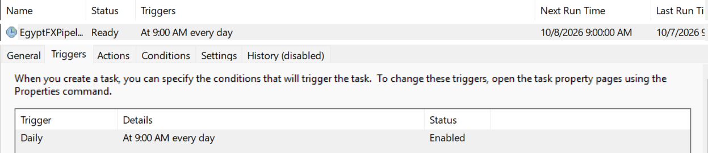

# Egypt FX Tracker — Automated Daily Data Pipeline

[](https://github.com/omartarekk9/Egypt-fx-pipeline/actions/workflows/ci.yml)

A Python pipeline that collects daily exchange rates of the **Egyptian pound (EGP)** against USD, EUR, GBP and the Gulf currencies (SAR, AED, QAR, KWD), validates them, stores them in a star-style schema, and analyses trends, volatility and big moves with SQL window functions.

It runs in two ways:

- **Windows + SQL Server Express**: the original setup, scheduled with Windows Task Scheduler, feeding a Power BI dashboard.
- **Docker + PostgreSQL + Airflow**: a portable setup (`docker compose`), orchestrated by an Airflow DAG (`extract -> validate -> load`).

Both use the same Python modules; only the loader and the scheduler differ.

## Why this project

Anyone who works with Egyptian or Gulf businesses cares about the EGP rate. This project shows the full data workflow on **real, daily-updating data**: ingestion → validation → warehouse → analysis → dashboard → orchestration → tests, and how it was hardened step by step (see the pull requests).

## Architecture

```
Free FX API (no key)        Python modules (src/)                    Warehouse
fawazahmed0/currency-api -> extract.py   exact-date fetch,        -> PostgreSQL (Docker)    or   SQL Server Express
                                         retry + fallback host,        fact_fx_rate                 fact_fx_rate
                                         404 = "missing at source"     dim_currency                 dim_currency
                            transform.py cross-rates (pandas)                                       vw_fx_daily
                            validate.py  checks before anything is loaded                           vw_fx_monthly
                            load_pg.py / load.py   idempotent upsert                                     |
                                                                                                         v
Run by:                                                                                           Power BI dashboard
  - Airflow DAG `egypt_fx_daily` (Docker)          FX_BACKEND=postgres
  - run_pipeline.py + Task Scheduler (Windows)     FX_BACKEND=sqlserver (default)
```

## Tech stack

Python (requests, pandas, psycopg2, pyodbc) · PostgreSQL · SQL Server / T-SQL (window functions, MERGE, views) · Apache Airflow 3 · Docker / Docker Compose · pytest + GitHub Actions · Windows Task Scheduler · Power BI

## Key design decisions

- **Idempotent loads.** The primary key is `(rate_date, currency_code)` and the load is an upsert (`MERGE` on SQL Server, `INSERT ... ON CONFLICT DO UPDATE` on Postgres), so running the pipeline twice never creates duplicates. A second run prints `Days to load: 0`.
- **Fail loudly.** If any day fails, `run_pipeline.py` exits with code 1, so a scheduler sees the failure. In Airflow a bad day turns its task red and nothing reaches the database. A day the source simply does not have yet (HTTP 404) is logged as a warning and does not fail the run.
- **Validate before load.** `src/validate.py` rejects a day with a wrong row count, duplicate or missing currencies, nulls, non-positive or non-finite rates, or an invalid or future date. A soft check warns when SAR or AED drift more than 0.5% from their dollar pegs. The tables also have a `CHECK (egp_per_unit > 0)` constraint.
- **Exact-date fetch.** The pipeline asks the API for the exact date and rejects a payload whose date differs. An earlier version used the `latest` alias, which can serve yesterday's file: today was logged as loaded but stored under the wrong date. A regression test covers it.
- **Self-healing.** Each daily run retries every missing day in the last 7 days (and catches up after longer downtime), so a failed day before a good one is not lost.
- **Resilient extract.** Retries with backoff and a fallback host. A 404 is permanent, so it is not retried.
- **Raw layer.** The Airflow `extract` task keeps the untouched API response in `data/raw/<date>.json`, so validate and load can be replayed without calling the API again.
- **ETL, not ELT, for the load.** The transformation is small (cross-rate arithmetic), and validation has to happen before data reaches the warehouse, so the data is transformed in Python first. The analysis (moving averages, volatility, monthly stats) runs inside the database as SQL views, which is the ELT style.
- **No secrets in the repo.** SQL Server uses Windows Authentication. Postgres credentials come from `.env`, which is git-ignored (`.env.example` is committed).
- **Tested.** pytest covers the transform math, the validation rules, the extract retries and 404 handling, and the Postgres upsert (with a fake connection). It runs in GitHub Actions on every push, with no database needed.

## Data model

| Table / View | Purpose |
| --- | --- |
| `dim_currency` | currency name, region, exchange-rate regime (floating / USD peg / basket peg) |
| `fact_fx_rate` | one row per date and currency: `egp_per_unit` (1 unit = ? EGP) |
| `vw_fx_daily` | daily change %, 7/30-day moving averages, 30-day volatility, big-move flag (SQL Server) |
| `vw_fx_monthly` | monthly open / close / min / max / change % (SQL Server) |

Schemas: `sql/01_schema.sql` (SQL Server) and `sql/postgres/01_schema.sql` (Postgres).

## How to run

### Option A: Docker + Postgres (+ Airflow)

Needs Docker Desktop. Airflow needs roughly 2 GB of RAM.

```
copy .env.example .env          # then set POSTGRES_PASSWORD (use plain characters, no @ : /)
docker compose up -d            # starts Postgres on localhost:5433 and creates the tables
```

Run the pipeline once, inside a container:

```
docker compose run --rm pipeline --backfill 30
docker compose run --rm pipeline            # daily run: loads only missing days
```

Run it with Airflow:

```
docker compose --profile airflow up -d --build airflow
```

Open <http://localhost:8080> and enable the `egypt_fx_daily` DAG. With `catchup=True` it runs every day since 2026-11-01, one day at a time. To test a single day without the scheduler:

```
docker compose exec airflow airflow dags test egypt_fx_daily 2026-11-10
```

If your Postgres volume already existed before Airflow was added, create its metadata database once: `docker compose exec postgres psql -U fx -d fxtracker -c "CREATE DATABASE airflow;"` (a fresh volume does this automatically through `sql/postgres/00_airflow_db.sql`).

To use the Python scripts directly against the Docker database instead of a container, set `FX_BACKEND=postgres` and run `python run_pipeline.py`.

### Option B: Windows + SQL Server (no Docker)

1. Install **SQL Server Express**, **SSMS**, **ODBC Driver 18 for SQL Server** and **Python 3.10+**.
2. `pip install -r requirements.txt`
3. In SSMS run `sql/01_schema.sql` (once).
4. If your instance name is not `localhost\SQLEXPRESS`, set `FX_SQL_SERVER` first, e.g. `set FX_SQL_SERVER=localhost`.
5. First load of the last year: `python run_pipeline.py --backfill 365`
6. In SSMS run `sql/02_views.sql`, then explore `sql/03_analysis_queries.sql`.
7. Tests: `pytest`

Automate it daily:

```
schtasks /Create /SC DAILY /ST 09:00 /TN "EgyptFXPipeline" /TR "C:\full\path\to\egypt-fx-pipeline\run_daily.bat"
```

Output and errors go to `pipeline.log`.

## Orchestration (Airflow)

`dags/egypt_fx_daily.py` has three tasks, `extract` -> `validate` -> `load`. One DAG run is one rate date (`{{ ds }}`), scheduled `@daily` with 2 retries and `max_active_runs=1`. The tasks import the same `src/` modules as `run_pipeline.py`, so there is no second copy of the logic. Rerunning a day overwrites the same raw file and upserts the same 7 rows.

## Analysis questions answered (`sql/03_analysis_queries.sql`)

1. Latest rate and 30-day change for every currency.
2. The ten biggest single-day moves of the pound against the dollar.
3. Best and worst months for the pound.
4. **Peg check**: SAR and AED are pegged to the dollar, so the implied SAR-per-USD should stay flat. This validates the data and shows why EGP/SAR moves with EGP/USD.
5. **Data quality**: detects missing days.
6. Which currency is the most volatile right now.

## Key findings

*(Snapshot analysed on 4 Oct 2026: 2,548 rows, 4 Oct 2025 – 3 Oct 2026, 7 currencies. A positive change means the dollar got more expensive, i.e. the pound weakened.)*

- **Overall trend:** USD/EGP moved from 47.73 to 52.22 over the year (about +9.4%).
- **March 2026 was the big month:** USD/EGP rose 14.07% within the month (47.73 → 54.45), the largest monthly move in the data. June 2026 was the largest retreat (−6.06%, 52.38 → 49.20).
- **Large daily moves cluster in spring:** only 5 days moved 2% or more (largest: +3.88% on 10 Mar 2026), and 6 of the 10 largest daily moves fall in March–April 2026.
- **Last 30 days:** the pound weakened about 2.3% against USD, AED, QAR and SAR, 0.3% against GBP, and strengthened 0.8% against EUR.
- **Gulf pegs:** AED tracks USD exactly (identical 30-day volatility, 0.3219). SAR holds its 3.75 peg within about 0.1% on almost every day, but 4 days deviate by more than 0.5% (largest: +1.03% on 18 May 2026 and −0.98% on 18 Sep 2026), and 7 of the 10 largest deviations fall between 7 and 18 May 2026. Since the peg itself did not change, these look like anomalies in the source data rather than real moves; this is why SAR shows slightly higher volatility than AED. The pipeline's peg check now flags this kind of drift at load time.
- **Data quality:** the gap-detection query found one day missing at the source (2025-12-10); the pipeline logged and skipped it. The first and last months (Oct 2025, Oct 2026) are partial months.
- **Automation check:** the scheduled task ran unattended on consecutive days (see `pipeline.log`), loading new days with `failed=0`.

## Dashboard

Power BI file: `FX_Dashboard.pbix` (reads the SQL Server views `vw_fx_daily` and `vw_fx_monthly`; a currency slicer drives every visual).

| USD overview | SAR (peg check) |
| --- | --- |
| [](screenshots/01_usd_overview.png) | [](screenshots/02_sar_peg.png) |

Scheduled task (runs daily at 09:00):

[](screenshots/03_scheduled_task.png)

## Repository layout

```
dags/egypt_fx_daily.py     Airflow DAG
src/                       extract, transform, validate, load (SQL Server), load_pg (Postgres)
tests/                     pytest suite
sql/                       SQL Server schema, views, analysis queries
sql/postgres/              Postgres schema and the Airflow metadata database
run_pipeline.py            command-line entry point (--backfill N, --lookback N, FX_BACKEND)
Dockerfile                 the pipeline in a container
Dockerfile.airflow         Airflow image (adds pandas)
docker-compose.yml         postgres, pipeline (profile "run"), airflow (profile "airflow")
```

## Data source and limitations

Rates come from the open [currency-api](https://github.com/fawazahmed0/exchange-api) (CC0, free, no key; daily history since March 2024). They are reference rates for analysis, not trading quotes, and can differ from bank or parallel-market rates.

- The analytical views (`vw_fx_daily`, `vw_fx_monthly`) and the Power BI dashboard still run on SQL Server. Porting the views to Postgres is the next step.
- The Airflow setup is for local use: `standalone` mode with the login screen disabled and no failure alerts (email or Slack) configured.
- Everything runs on one machine. There is no cloud deployment yet.
